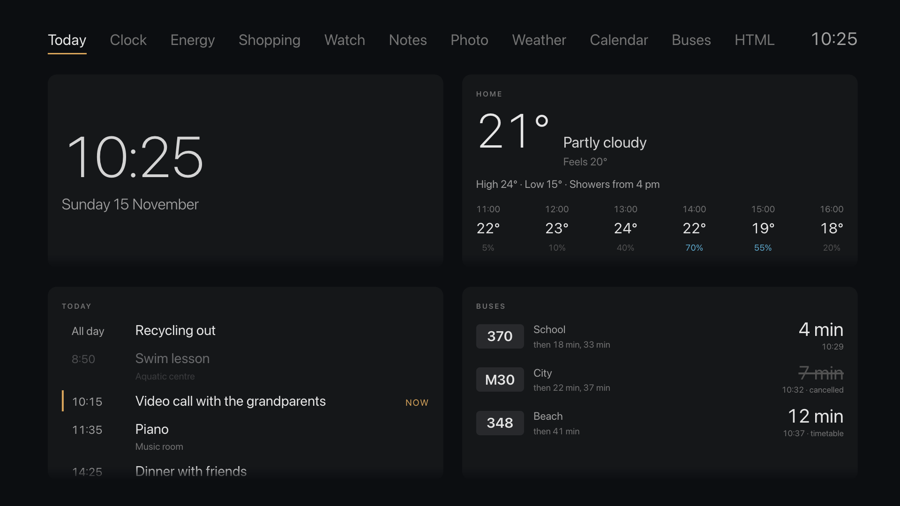

# cast

A Google Cast Web Receiver that puts dashboards on a Google TV. A program on your network launches it and pushes screens as JSON; the TV shows them. The receiver holds no data, fetches nothing and never runs sender JavaScript. It will live at `https://cast.khalido.dev/receiver`.



- **Blocks**: `clock`, `stat`, `list`, `cards`, `text`, `image`, `weather`, `calendar-day`, `week`, `bus`. Sized for a TV across a room (1 rem = 1/54 of the screen height), dark, with 5% safe margins. Times count down on the TV, so a bus board stays right between updates.
- **HTML screens**: your HTML and CSS, sanitised with DOMPurify and shown in a Shadow DOM.
- **Theme**: accent colour, density, time zone, 12-hour clock.
- **Protocol** (v1, namespace `urn:x-cast:dev.khalido.cast`): `screens`, `screen`, `show`, `theme`, `clear`, with `ack`/`error` replies. Payloads over 60 KB go in parts and are joined on the TV. The newest `revision` wins. Full spec on the home page (`/`) and in [`src/llms.txt`](src/llms.txt) (served as `/llms.txt` with the limits filled in); the schema is [`src/protocol/schema.ts`](src/protocol/schema.ts).
- **Remote**: Back or leaving the app closes it, left/right switch screens, up/down move a focus ring over rows; other keys go to the senders as `key` messages. A `banner` message puts a line over any screen; `theme.rotate` cycles screens.
- Without a sender it shows a clock and "Waiting for a sender".

## Run it

```bash
bun install
bun run dev          # http://localhost:5173/receiver?demo  and  / for the home page
bun run test         # vitest: chunk join, limits, revision rule, sanitiser, markdown
bun run check        # svelte-check
bun run build        # static site in dist/
```

Demo options: `/receiver?demo=waiting`, `?demo&screen=bus` (any id from [`src/protocol/examples.ts`](src/protocol/examples.ts)), `&density=compact`, `&accent=%237aa2c8`, `&hour12`. In the console, `demo.send('show', { screen: 'weather' })` sends more.

## Send to it

[`examples/sender.ts`](examples/sender.ts) (TypeScript, `@khalido/home`) and [`examples/sender.py`](examples/sender.py) (Python, pychromecast) launch the app and push a screen. `split()` in [`src/protocol/split.ts`](src/protocol/split.ts) cuts a payload into parts. [`examples/listen.py`](examples/listen.py) pings a TV and prints what it sends back (acks, errors, the pong with its user agent, remote keys).

## Layout

- `receiver.html`: the receiver page. Its top comment says what it is.
- `src/protocol/`: schema, `split()` (sender), `core.ts` (join, limits, revision; no DOM), sanitiser, examples.
- `src/receiver/`: Cast and demo transports, the page, the blocks.
- `src/landing/`: the home page.
- `wrangler.jsonc`: Cloudflare static assets for `cast.khalido.dev`.

This folder is its own package inside chota-bot: run `bun` commands from `cast/`. chota's root lint (prettier, eslint) covers it; its build output `dist/` is ignored.

## Deploy

```bash
bun run build
CLOUDFLARE_ACCOUNT_ID=<the khalido.dev account> bunx wrangler deploy
```

The account id stays out of the repo. wrangler can also see other people's accounts, so always set it.

## Security

The receiver's Content-Security-Policy (added at build, see `vite.config.ts`): scripts only from this site and `www.gstatic.com` (Google's receiver SDK), images and fonts from `https:` and `data:`, no frames, forms or other connections. `connect-src` allows `ws://localhost:*` and nothing else: the Cast SDK talks to the TV over a WebSocket to `ws://localhost:<port>/v2/ipc`, so `'none'` would stop it working.
